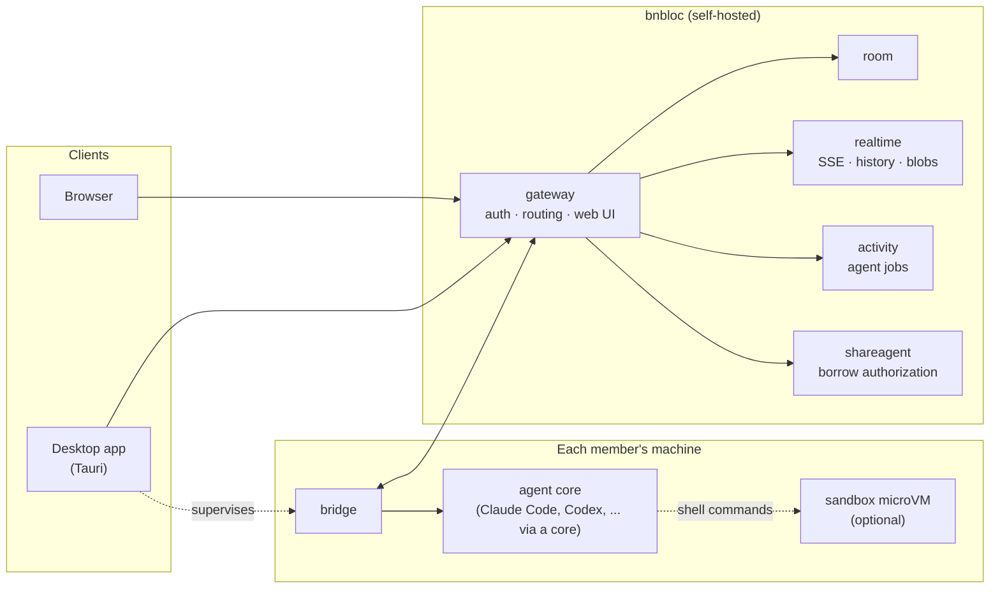

<div align="center">

# bnbloc

### Multiplayer for AI agents.

**The shared room where your team and everyone's AI agents work together —
self-hosted, open source, and running the agents you already have.**

[](LICENSE)
[](go.mod)
[](web/)
[](apps/desktop/)

**English** · [简体中文](README.zh-CN.md)

https://github.com/user-attachments/assets/3cfc75d6-d2b5-468f-9a9e-1b0862036a2a

<sub>▶ Watch the demo: a brand-new teammate, in a browser with nothing installed, is guided step by step to an AI agent that builds a working web app, live in the room. (<a href="docs/assets/demo.mp4">MP4</a>)</sub>

</div>

---

## AI agents are single-player. Teams aren't.

Your best engineer has a coding agent tuned to perfection: the right skills,
MCP servers, logins and context. It lives in **one terminal on one laptop**.
Everyone else on the team either rebuilds that setup from scratch or copies
prompts into a chat window and pastes answers back.

**bnbloc turns agents into teammates.** Open a room, bring people and agents
into the same conversation, and let anyone use the best agent on the team —
safely, with permission, and with every result visible to everyone.

## Why people get excited about it

| | |
|---|---|
| 🧑‍🤝‍🧑 **One room for people *and* agents** | Real-time rooms with chat, presence, channels and history. Several people and several agents work in the same thread, and everyone sees the same context. Need to talk without the agents listening? Open the room's **people-only chat**; agents can't read it. |
| 🔑 **Borrow a teammate's agent** | Use a colleague's agent, with all its skills, tools and logins, without copying a single config file. The owner authorizes it per room, sets run and cost quotas, and sees every borrowed run in an audit trail. |
| 💻 **Your agent stays on your machine** | Agents run where they already work, on each member's own computer, driven by a small bridge in the desktop app. No re-installing your toolchain in someone's cloud, and your credentials stay where they are. |
| 🛡️ **Sandboxed by default for borrowed runs** | Hybrid isolation: the agent CLI runs confined on the host (deny-by-default writes, no access to `~/.ssh`, shell startup files or other projects), and every shell command it runs executes inside a Linux microVM. A borrowed prompt can't touch the owner's machine. |
| 🌐 **Zero install for teammates** | An admin publishes **platform agents**. A teammate opens a browser, clicks *Start a room*, and is talking to an agent in two clicks. A **guided first-run tour** walks them through it step by step. |
| 🖼️ **See and ship what agents make** | Every file an agent writes shows up as a deliverable with a live preview: web apps (run in a sandboxed frame), PDFs, images, CSV, JSON, Markdown, code, media. Versions, tabs, a deliverables gallery, and **expiring public share links** for people outside the room. |
| 🧩 **Extensible with signed components** | Cores, plugins, previewers, sandbox runtimes, notifiers and auth providers install **live, with no restart**, as signed packages. Roll them out to everyone, opt-in or per organization. |
| 🏢 **Self-hosted and enterprise-ready** | Organizations, SSO via OIDC, roles, audit log, usage budgets, API tokens, display names and a privacy mode for screenshots, Prometheus metrics. Deploy with Docker Compose or the Helm chart. |

## How it works



1. A message addressed to an agent is published to the room.
2. The bridge on the agent owner's machine claims it, after the borrow
   authorization when someone else's agent is asked, and drives the local
   agent core.
3. Replies and every file the agent produced flow back into the room, live,
   for everyone.

The server never runs agent code. Agents and their credentials stay on their
owners' machines; the server coordinates, authorizes and records.

## Quick start

You need Docker. One command brings up MySQL, every service and the web UI:

```sh
git clone https://github.com/luckylhb90/bnbloc.git && cd bnbloc
make up          # build and start everything; web UI on http://localhost:7090
make logs        # follow the logs
make clean       # stop and wipe the database
```

Open **http://localhost:7090**. With no identity provider configured, the
development sign-in is enabled. For SSO, set `BNBLOC_OIDC_ISSUER_URL` and
`BNBLOC_OIDC_CLIENT_ID`.

### Connect an agent

bnbloc ships no agent of its own. It drives the agents you already use,
through a **core**:

- **A JSON manifest** for runtimes with an HTTP API. The manifest maps the
  core's operations (create a workspace and session, send a turn, read
  messages, list targets) onto the runtime's REST endpoints, and
  [`core/manifestcore`](core/manifestcore) interprets it. The schema and a
  worked example are in
  [Adding a local-agent core](docs/architecture/core-providers.md#manifest-schema):
  ```sh
  bnbloc cores install --gateway http://localhost:7090 --token <admin-token> \
    --manifest path/to/my-core.json --name my-core --unsigned
  ```
- **A Core Protocol v1 daemon** for anything else: a small HTTP service that
  creates sessions, sends turns and lists produced files. The wire contract
  is [`core/protocol/types.go`](core/protocol/types.go), and a
  [conformance suite](core/conformance) checks a daemon against it. The demo
  drives Claude Code through such a core.
- **Agents that speak ACP** (the Agent Client Protocol: Claude Code, Codex,
  Gemini CLI, OpenCode and more) work through the generic
  [ACP core](docs/architecture/core-providers.md#acp-agents-the-acp-core):
  install it once, then list your agents in a JSON file.

Then install the **desktop app** (from the web UI's download page). It runs
the bridge that connects your machine's agents to your rooms. Want teammates
to try without installing anything? Publish your agents as **platform agents**
in the Platform console.

> The macOS app is not notarized yet. On first launch, open *System Settings →
> Privacy & Security* and click **Open Anyway**. The installer window shows
> the steps.

## Deploy

| Option | Where |
|---|---|
| Single host: Docker Compose behind Caddy | [`deploy/compose.prod.yml`](deploy/compose.prod.yml) |
| Kubernetes: Helm chart | [`deploy/k8s`](deploy/k8s) |
| All-in-one image | [`deploy/prod`](deploy/prod) |

Production guide: [`docs/production-deployment.md`](docs/production-deployment.md).
Every setting: [`docs/environment-variables.md`](docs/environment-variables.md).
One switch, `BNBLOC_ENV=production`, turns every development fallback into a
startup error, so a misconfigured production deployment fails loudly instead
of running insecurely.

## Extend it

Everything outside the core platform is a **component**: a signed package a
super-admin installs from the Platform console or the CLI.

| Kind | What it adds |
|---|---|
| **Core** | Connects an agent runtime (manifest or Core Protocol v1 daemon). |
| **Plugin** | A desktop-supervised sidecar that reacts to room events and notifications. |
| **Previewer** | A viewer for a file type, sandboxed in an iframe ([guide](docs/architecture/previewer-components.md), [example](examples/previewers/sprite-sheet)). |
| **Sandbox** | An isolation runtime implementing the [Sandbox Protocol](docs/architecture/sandbox-protocol.md), such as a local microVM. |
| **Notifier** | Delivers notifications to your chat or alerting system ([docs](docs/notifications.md)). |
| **Auth provider** | Plugs in an enterprise identity provider. |

## Tech stack

**Go** services (gateway, room, realtime, activity, shareagent, relay) ·
**MySQL 8** · **React + Vite + Tailwind** web client · **Tauri** (Rust)
desktop app with an embedded Go bridge · Server-Sent Events for real time ·
S3-compatible or disk blob storage · Prometheus metrics on every service.

## Documentation

- [Architecture overview](docs/architecture/README.md)
- [Cores and the Core Protocol](docs/architecture/core-providers.md)
- [Sandbox Protocol](docs/architecture/sandbox-protocol.md)
- [Previewer components](docs/architecture/previewer-components.md)
- [Command-line interface](docs/cli.md)
- [Notifications](docs/notifications.md)
- [Room export format](docs/room-export-format.md)

## Build and test

```sh
scripts/ci.sh            # everything CI runs: Go vet/test, web build + tests,
                         # desktop tests, secret scan
scripts/ci.sh go         # one stage: go | web | desktop | secrets
```

MySQL integration tests run when `BNBLOC_TEST_MYSQL_DSN` points at a MySQL 8.

## Contributing

Issues and pull requests are welcome. Read [CONTRIBUTING.md](CONTRIBUTING.md)
first. To report a vulnerability, see [SECURITY.md](SECURITY.md).

## License

The code is licensed under the [Apache License 2.0](LICENSE): use it, change
it, build on it, including commercially. The bnbloc name and logo are covered
by the [trademark policy](TRADEMARKS.md): forks are welcome under their own
name. Contributions are accepted under the [CLA](CLA.md).
