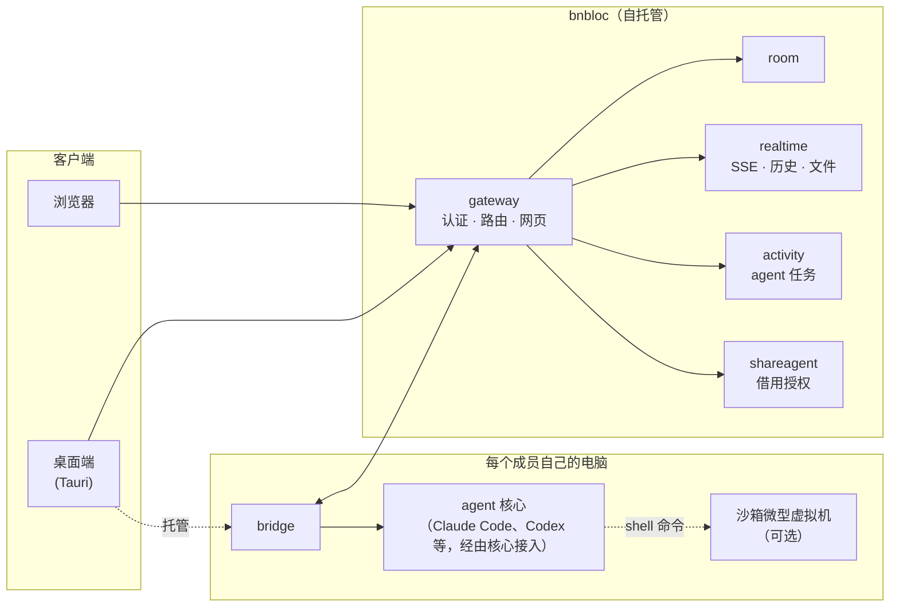

<div align="center">

# bnbloc

### 让 AI agent 也能多人协作。

**一个让团队成员和每个人的 AI agent 在同一个房间里协作的地方：
自托管、开源，直接用你已经在用的 agent。**

[](LICENSE)
[](go.mod)
[](web/)
[](apps/desktop/)

[English](README.md) · **简体中文**

https://github.com/user-attachments/assets/3cfc75d6-d2b5-468f-9a9e-1b0862036a2a

<sub>▶ 观看演示：一位什么都没装、只开着浏览器的新同事，在新手引导下一步步请 AI agent 做出了一个能直接运行的网页应用，并在房间里实时预览。 (<a href="docs/assets/demo.mp4">下载 MP4</a>)</sub>

</div>

---

## AI agent 都是「单机版」，可团队不是

团队里最厉害的工程师，往往有一个调教得非常顺手的编程 agent：合适的
skills、MCP 服务、各种登录和上下文都配好了。但它只活在**一台笔记本的一个
终端里**。其他人要么从头再配一遍，要么把提示词复制到聊天窗口，再把答案
粘贴回来。

**bnbloc 让 agent 成为团队成员。** 开一个房间，把人和 agent 拉进同一个对话，
团队里任何人都能用上团队里最好的 agent：安全、经过授权，而且每个结果
所有人都看得见。

## 为什么值得一试

| | |
|---|---|
| 🧑‍🤝‍🧑 **人和 agent 在同一个房间** | 实时房间：聊天、在线状态、频道、历史记录都有。多个人和多个 agent 在同一个对话里协作，所有人看到的上下文一致。想私下讨论、不让 agent 听到？打开房间的**人员专用聊天**，agent 读不到。 |
| 🔑 **借用同事的 agent** | 直接用同事的 agent，连同它的 skills、工具和登录状态，一个配置文件都不用拷。owner 按房间授权，设置次数和费用额度，每次借用都记录在审计日志里。 |
| 💻 **agent 留在你自己的电脑上** | agent 就在它原本工作的地方运行，也就是每个成员自己的电脑，由桌面端里一个小小的 bridge 驱动。不用把工具链重装到别人的云上，你的凭证也不会离开本机。 |
| 🛡️ **借用默认跑在沙箱里** | 混合隔离：agent 的命令行在本机上受限运行（默认禁止写入，读不到 `~/.ssh`、shell 启动文件和其他项目），它执行的每一条 shell 命令都在 Linux 微型虚拟机里跑。别人的提示词碰不到 owner 的电脑。 |
| 🌐 **同事零安装** | 管理员发布**平台 agent**。同事打开浏览器，点一下「Start a room」，两次点击就能和 agent 对话。**游戏式新手引导**一步步带着走完第一次使用。 |
| 🖼️ **看得见、发得出 agent 做的东西** | agent 写出的每个文件都会成为可实时预览的交付物：网页应用（在沙箱框架里运行）、PDF、图片、CSV、JSON、Markdown、代码、音视频。支持版本、多标签、交付物画廊，还能生成**会过期的公开分享链接**，发给房间外的人看。 |
| 🧩 **签名组件，随装随用** | 核心、插件、预览器、沙箱运行时、通知器、身份提供方，都以签名包的形式**在线安装、无需重启**。可以全员开放、按需加入，或者只对某些组织开放。 |
| 🏢 **自托管，面向企业** | 组织、OIDC 单点登录、角色、审计日志、用量预算、API token、显示名和截图用的隐私模式、Prometheus 指标。用 Docker Compose 或 Helm chart 部署。 |

## 工作原理



1. 发给某个 agent 的消息被发布到房间里。
2. agent owner 电脑上的 bridge 认领这条消息（如果是借用别人的 agent，先过
   借用授权），然后驱动本机的 agent 核心。
3. 回复和 agent 产出的每个文件实时回到房间，所有人都能看到。

服务端从不运行 agent 代码。agent 和它的凭证留在各自 owner 的电脑上；服务端
只负责协调、授权和记录。

## 快速开始

需要 Docker。一条命令就能启动 MySQL、所有服务和网页：

```sh
git clone https://github.com/luckylhb90/bnbloc.git && cd bnbloc
make up          # 构建并启动全部服务，网页在 http://localhost:7090
make logs        # 查看日志
make clean       # 停止并清空数据库
```

打开 **http://localhost:7090**。没有配置身份提供方时，会启用开发用的登录方式。
要接 SSO，设置 `BNBLOC_OIDC_ISSUER_URL` 和 `BNBLOC_OIDC_CLIENT_ID`。

### 接入 agent

bnbloc 自己不带 agent，它通过**核心**驱动你已经在用的 agent：

- **JSON 配置**：适用于提供 HTTP API 的运行时。配置文件把核心的各项操作
  （创建工作区和会话、发送对话、读取消息、列出目标）映射到运行时的 REST
  接口上，由 [`core/manifestcore`](core/manifestcore) 解释执行。字段说明和
  完整示例见
  [Adding a local-agent core](docs/architecture/core-providers.md#manifest-schema)：
  ```sh
  bnbloc cores install --gateway http://localhost:7090 --token <admin-token> \
    --manifest path/to/my-core.json --name my-core --unsigned
  ```
- **Core Protocol v1 守护进程**：适用于其他任何 agent。它是一个很小的 HTTP
  服务，负责创建会话、发送对话、列出产出的文件。协议约定见
  [`core/protocol/types.go`](core/protocol/types.go)，仓库里还带了
  [一致性测试](core/conformance)，可以用来检查你的实现。演示视频里的
  Claude Code 就是这样接进来的。
- **支持 ACP 的 agent**（Agent Client Protocol：Claude Code、Codex、
  Gemini CLI、OpenCode 等）通过开源的
  [bnbloc-acp](https://github.com/luckylhb90/bnbloc-acp) 核心组件接入：
  装一次，再在一个 JSON 文件里列出你的 agent 即可。

然后安装**桌面端**（在网页的下载页面）。它运行的 bridge 会把你电脑上的
agent 接到你的房间里。想让同事不装任何东西就能试？在 Platform 控制台里把你
的 agent 发布成**平台 agent**。

> macOS 版目前还没有经过公证。第一次打开时，进入「系统设置 → 隐私与安全性」，
> 点「仍要打开」。安装窗口里有图示步骤。

## 部署

| 方式 | 位置 |
|---|---|
| 单机：Docker Compose + Caddy | [`deploy/compose.prod.yml`](deploy/compose.prod.yml) |
| Kubernetes：Helm chart | [`deploy/k8s`](deploy/k8s) |
| 一体化镜像 | [`deploy/prod`](deploy/prod) |

生产部署指南：[`docs/production-deployment.md`](docs/production-deployment.md)。
全部配置项：[`docs/environment-variables.md`](docs/environment-variables.md)。
只需一个开关 `BNBLOC_ENV=production`，所有开发用的兜底配置都会变成启动报错，
配错的生产环境会直接起不来，而不是带着安全隐患跑下去。

## 扩展

核心平台之外的一切都是**组件**：由超级管理员在 Platform 控制台或命令行里
安装的签名包。

| 类型 | 作用 |
|---|---|
| **核心（Core）** | 接入一个 agent 运行时（JSON 配置或 Core Protocol v1 守护进程）。 |
| **插件（Plugin）** | 由桌面端托管的 sidecar，响应房间事件和通知。 |
| **预览器（Previewer）** | 某种文件类型的查看器，运行在沙箱 iframe 里（[指南](docs/architecture/previewer-components.md)、[示例](examples/previewers/sprite-sheet)）。 |
| **沙箱（Sandbox）** | 实现 [Sandbox Protocol](docs/architecture/sandbox-protocol.md) 的隔离运行时，比如本地微型虚拟机。 |
| **通知器（Notifier）** | 把通知投递到你的聊天或告警系统（[文档](docs/notifications.md)）。 |
| **身份提供方（Auth provider）** | 接入企业身份系统。 |

## 技术栈

**Go** 服务（gateway、room、realtime、activity、shareagent、relay）·
**MySQL 8** · **React + Vite + Tailwind** 网页 · **Tauri**（Rust）桌面端，
内置 Go 写的 bridge · 实时通信用 Server-Sent Events · 文件存储支持
S3 兼容存储或本地磁盘 · 每个服务都提供 Prometheus 指标。

## 文档

- [架构总览](docs/architecture/README.md)
- [核心与 Core Protocol](docs/architecture/core-providers.md)
- [Sandbox Protocol](docs/architecture/sandbox-protocol.md)
- [预览器组件](docs/architecture/previewer-components.md)
- [命令行工具](docs/cli.md)
- [通知](docs/notifications.md)
- [房间导出格式](docs/room-export-format.md)

## 构建与测试

```sh
scripts/ci.sh            # CI 的全部检查：Go vet/test、网页构建和测试、
                         # 桌面端测试、密钥扫描
scripts/ci.sh go         # 只跑一个阶段：go | web | desktop | secrets
```

设置 `BNBLOC_TEST_MYSQL_DSN` 指向一个 MySQL 8，就会运行 MySQL 集成测试。

## 参与贡献

欢迎提 issue 和 pull request，动手前请先看 [CONTRIBUTING.md](CONTRIBUTING.md)。
报告安全漏洞请看 [SECURITY.md](SECURITY.md)。

## 许可证

代码采用 [Apache License 2.0](LICENSE)：可以自由使用、修改、二次开发，包括商业
用途。bnbloc 的名称和 logo 受[商标政策](TRADEMARKS.md)约束：欢迎 fork，但请用
你自己的名字。贡献代码需要接受 [CLA](CLA.md)。
